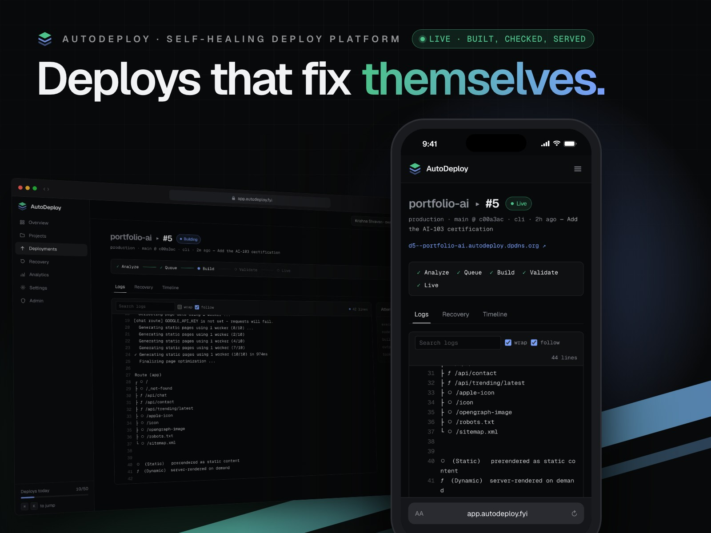
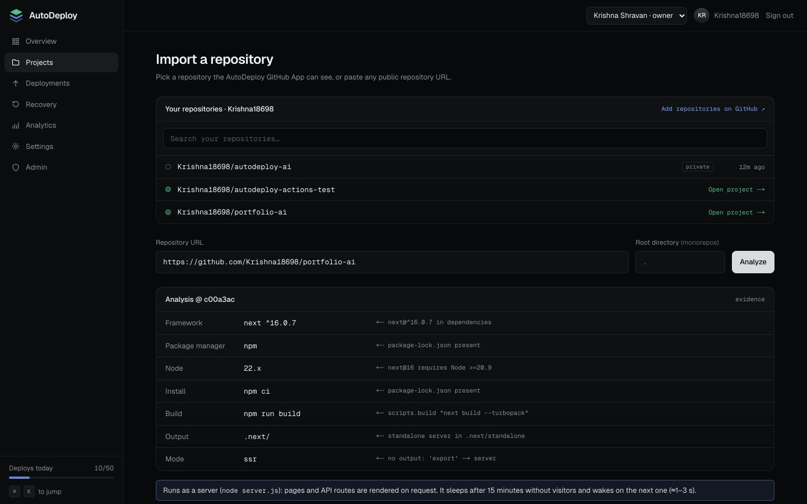
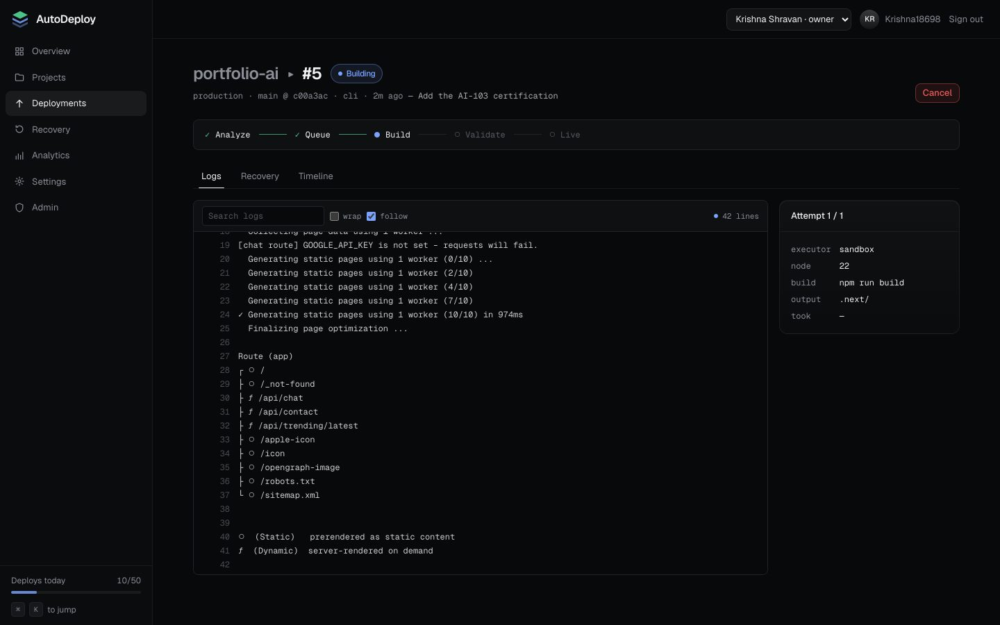
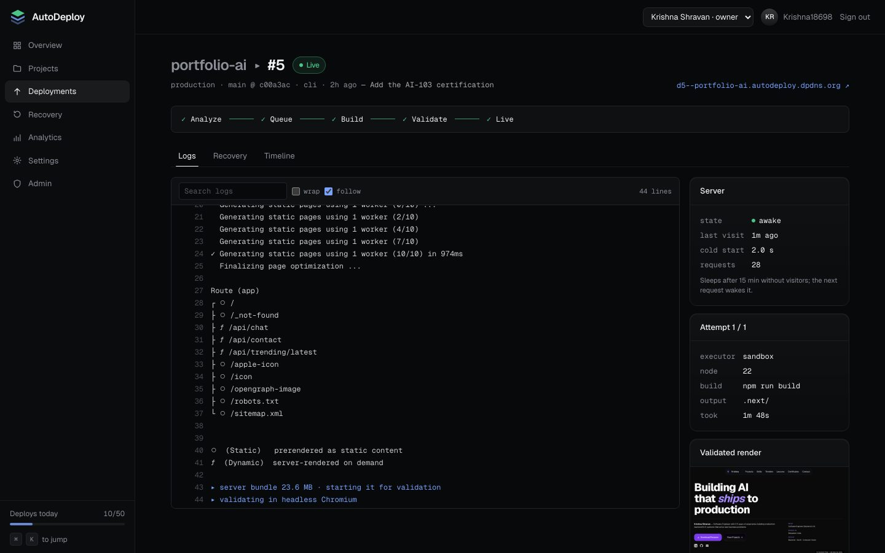
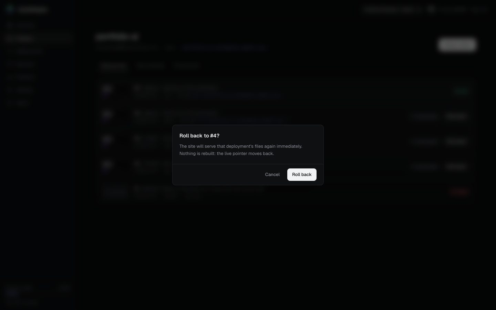
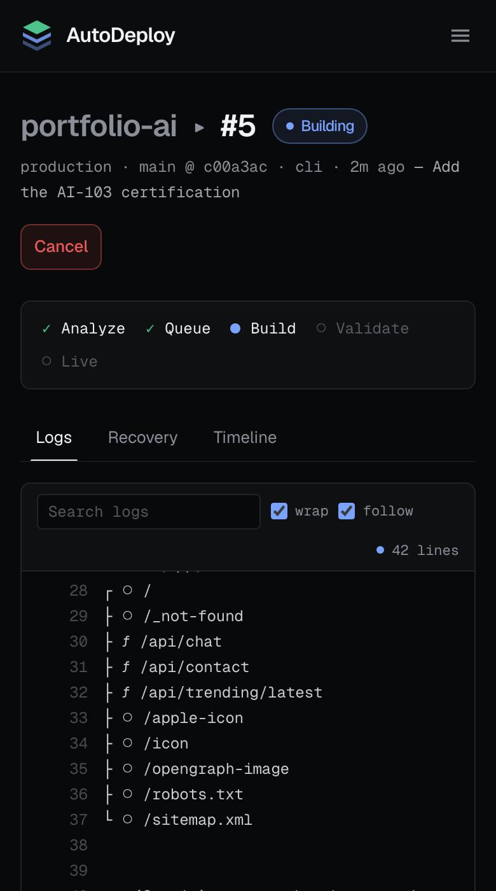
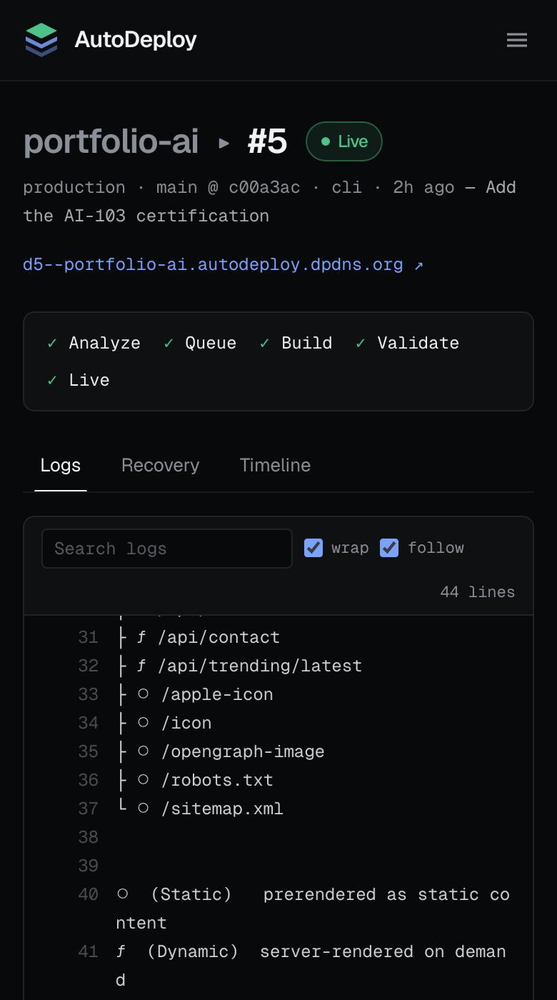

# AutoDeploy



**Deploys that fix themselves.** Connect a repository; AutoDeploy works out
how to build it, builds it in a sandbox, repairs the failures it understands,
validates the result in a real browser, and serves it from the edge — showing
every decision it made along the way.

A portfolio project focused on backend reliability: job orchestration,
failure recovery, multi-tenant security and observability, on a ₹0 budget.

**Try it:** sign in at [app.autodeploy.fyi](https://app.autodeploy.fyi) with
GitHub, Google or email and you open in a read-only demo with real deploys:
a [Vite site](https://demo-vite.autodeploy.dpdns.org), a server-rendered
[Next.js app](https://demo-next.autodeploy.dpdns.org), a
[type error the AI repaired](https://demo-ai-fix.autodeploy.dpdns.org) and a
person approved, and a [build that failed](https://demo-env.autodeploy.dpdns.org)
until it was given an environment variable. Deploying your own repositories is
by approval ([ADR 0012](docs/adr/0012-portfolio-mode.md)).

```
GitHub ─webhook─▶ API (Fastify, 2×) ─tx─▶ Postgres ── jobs (SKIP LOCKED, leases)
                     │  RLS · idempotency · rate limits     │      outbox ─▶ Kafka ─┬─ realtime  → SSE
                     ▼                                       ▼                      ├─ notifier  → webhooks · email
                 Dashboard (Next.js)                   Worker ──▶ gVisor sandbox     └─ analytics → projection (replayable)
                                                          │  rules → AI gateway → approval
                                                          ▼
                                    Backblaze B2 (content-addressed) ◀── Edge Worker (*.domain, KV routes)
```

## What it does

- **Analyzes** a repo deterministically (framework, package manager, Node
  version, build command, output dir, SSR vs static, env vars) and shows the
  evidence for every inference.
- **Builds** each attempt in a fresh gVisor container: read-only root, dropped
  capabilities, cgroup limits, no network except an allowlisting proxy to the
  package registries.
- **Recovers**: error signatures → deterministic, configuration-only rules
  (Node version, output dir, lockfile, heap) → deterministic fixes to the code
  (trailing commas in JSON) → AI diagnosis and a minimal patch. Every change to
  the code is policy-checked, rebuilt, validated, and **approved by a human**.
  Validated rule fixes become project settings.
- **Validates** in headless Chromium with no network, and keeps a screenshot.
- **Ships** content-addressed artifacts; going live or rolling back moves one
  pointer (measured 11.7 ms).
- **Runs server-rendered apps** (Next.js, Nuxt, SvelteKit, Astro, Remix, React
  Router, SolidStart, or any Node server with a start script) as gVisor
  containers that wake on the first request and sleep after 15 idle minutes, so
  one free VM hosts many of them ([ADR 0008](docs/adr/0008-ssr-runtime.md)).
  Users' sites share one domain, so the gateway keeps each one's cookies its
  own: no `Domain=` sharing, sessions stored as `__Host-` cookies another site
  can't plant, and a sibling site's forms treated as cross-site
  ([ADR 0011](docs/adr/0011-cookies-on-the-shared-sites-domain.md)).
  A site's server that dies (killed for going over its memory, say) is
  noticed and started again on the next visit, which the gateway retries for
  it, instead of failing every visitor until a redeploy.
- **Builds on GitHub Actions** instead, if a project chooses: the repository's
  own workflow builds it and hands the output back over OIDC, so nothing but
  the build's result reaches the VM ([ADR 0010](docs/adr/0010-builds-on-github-actions.md)).
- **Streams** build logs and status over SSE (resumable), via Kafka.
- **Signs people in** with GitHub, Google, or email and a password (scrypt hashes,
  confirmed addresses, single-use reset links, no account enumeration). One
  account per confirmed email: Google joins the account whose address was
  proven by a link or by Google, never one only typed in. Session
  cookies are host-only with the `__Host-` prefix, so the sites users deploy
  under the same domain never receive them.

## Screens

Real production data: one deploy of the owner's portfolio, from analysis to live.

| | |
|---|---|
|  |  |
| **Import** — what it detected, and why | **Build** — logs stream as it builds |
|  |  |
| **Live** — validated in a real browser first | **Rollback** — a pointer flip, nothing rebuilt |

<p>
  
  
</p>

Every screen, the covers and a hover video come from
[`tools/screenshots`](tools/screenshots), which captures the real product and
re-runs after UI changes.

## Measured

| | |
|---|---|
| Duplicate job claims, 500 jobs and 8 workers competing | **0** |
| 100 concurrent redeliveries of one GitHub webhook | **1** deployment |
| Kafka killed mid-deploy | deploy still went live; the **11** queued events went out **6.5 s** after it returned |
| Rebuilding analytics by replaying Kafka | **50** events in **225 ms** |
| Cross-tenant access, every role × every route | **0** leaks |
| Failure corpus (38 repos): recovered by rules + AI | **82%**, **0** false fixes |
| Real-AI repair (NVIDIA, 11 cases × 3 runs) | **21/24** fixed, **9/9** unfixable escalated, **0** false fixes |
| A real type error in production: failed build → AI fix rebuilt, validated, waiting for a person | **43–46 s** |
| Sandbox escape attempts in production | **10/10** contained |
| Rollback through the API | **11.7 ms**, nothing rebuilt |
| Server-rendered sites awake at once on the free VM | **20** in ~1.1 GiB; ~15,000 requests, all 200 |
| The owner's Next.js portfolio, build start to live in production | **133 s** |

Every number, with the command that produced it and the bugs the tests found:
[`docs/measurements.md`](docs/measurements.md).

## Backend concepts, and where they live

| Concept | Where |
|---|---|
| Job queue: SKIP LOCKED, per-org fairness, leases + heartbeats, reaper, backoff with jitter, dead-letter, cancellation | `packages/queue` |
| State machine enforced in code **and** by a DB trigger | `packages/core/src/state-machine.ts`, `packages/db/migrations` |
| Transactional outbox → Kafka; idempotent consumers; DLQ; replay | `packages/db/src/outbox.ts`, `packages/events`, `apps/worker/src/consumers` |
| Multi-tenancy: roles, scoped API tokens, Postgres RLS | `apps/api/src/plugins/auth.ts`, `packages/db/src/with-org.ts` |
| Idempotency keys, sliding-window rate limits (Lua), CSRF, audit log | `apps/api/src/plugins` |
| Webhooks in (HMAC, delivery dedupe) and out (signed, retried, SSRF-guarded) | `apps/api/src/routes/github-webhooks.ts`, `apps/worker/src/jobs/integrations.ts` |
| Envelope encryption with key rotation | `packages/crypto` |
| Circuit breakers, retries, timeouts, bulkheads | `packages/resilience`, `packages/ai` |
| OpenTelemetry traces across API → queue → worker; Prometheus metrics | `packages/telemetry`, `apps/worker/src/metrics.ts` |
| Leader-elected maintenance (advisory lock) | `apps/worker/src/cron.ts` |
| Scale-to-zero containers: on-demand start, idle reaping, LRU cap, cold-start tracking, SSRF-guarded egress | `apps/worker/src/gateway*`, `infra/sandbox/egress` |
| Zero-downtime deploys, encrypted backups, restore drill, IaC | `infra/` |
| Portfolio mode: a read-only demo for everyone, deploys by approval | `apps/api/src/services/portfolio.ts`, `apps/api/src/routes/admin.ts` |

Decisions and trade-offs are in [`docs/adr`](docs/adr); numbers in
[`docs/measurements.md`](docs/measurements.md).

## Run it locally

Requirements: Node 24, pnpm 10, Docker.

```bash
pnpm install
cp .env.example .env            # then fill ENCRYPTION_KEYS and INTERNAL_TOKEN (commands inside)
pnpm infra:up                   # Postgres, Valkey, Kafka, S3 (SeaweedFS), egress proxy
NODE_MAJORS="20 22 24" pnpm --filter @autodeploy/worker sandbox:images
./scripts/dev.sh start          # api :4000 · worker :9464 · web :3000 · edge :8787
```

Open http://localhost:3000, use **Developer sign-in**, and import a public
GitHub repo — or a fixture: `file:///…/tests/fixtures/ts-error` with
`AI_PROVIDERS=mock` shows the whole AI-repair path without any API keys.
API docs: http://localhost:4000/docs.

## Tests

```bash
pnpm test               # 348 unit tests (pure domain code, the gateway, real Chromium for cookies)
pnpm test:integration   # 124 tests on real Postgres / Valkey / Kafka (Testcontainers),
                        #   including an authorization matrix generated from every route
pnpm test:e2e           # 8 Playwright tests against the running stack
pnpm test:smoke         # 18 end-to-end checks of what a user does (see below)
pnpm corpus --mode ai   # 38 labelled repos deployed for real (also --mode rules)
pnpm tsx tests/ai-eval/repair.ts   # real-AI repair on the corpus's AI cases, no containers
pnpm chaos              # kill the worker, Kafka, DB connections, storage mid-deploy
pnpm load               # k6: 100 concurrent deploys + polling dashboards
```

The smoke suite imports real apps from [`tests/e2e/fixtures`](tests/e2e/fixtures)
through the UI (a Vite site, a pnpm project pinned to a version the build image
lacks, server-rendered Next.js and Node apps (SvelteKit, Astro and Nuxt with
`E2E_FRAMEWORKS=1`), and one that fails until an env var is
set), checks each one live, clicks through every dashboard page at desktop and
phone widths, and deletes what it created. It runs locally with dev sign-in,
or against production with an API token:

```bash
# token from Settings → API tokens (scope: admin), saved to the git-ignored file
E2E_BASE_URL=https://app.autodeploy.fyi pnpm test:smoke   # reads infra/deploy/.e2e-token
```

Results and the bugs they caught: [`docs/measurements.md`](docs/measurements.md).

## Repository

```
apps/      api · worker · web (landing + dashboard) · edge (Cloudflare Worker) · cli
packages/  core (pure domain) · contracts · db · queue · events · ai · github · storage · crypto · resilience · telemetry
infra/     compose (local) · deploy (prod) · sandbox · terraform · backup · observability
docs/      adr · runbooks · measurements · screenshots
tests/     unit · integration · e2e · fixtures (failure corpus) · chaos · load
tools/     screenshots (captures the real product; its flows run read-only against production)
```

## Status

**Live** at [app.autodeploy.fyi](https://app.autodeploy.fyi), in portfolio
mode ([ADR 0012](docs/adr/0012-portfolio-mode.md)): anyone can sign in and look
around a read-only demo of real deploys; deploying your own repositories is by
approval (asked for from the dashboard, decided by an admin, answered by
email), with per-account limits after that. Sites are served at
`<name>.autodeploy.dpdns.org`:

- API, worker, SSR gateway, Postgres, Valkey and Kafka on one Oracle Cloud
  Always Free VM (Ampere A1), reached only through a Cloudflare Tunnel. Sites
  and builds share at most 90% of its CPUs, so the platform always keeps 10%.
- Sites served by a Cloudflare Worker from Backblaze B2, which keeps serving
  when Workers KV fails; the dashboard on Vercel, calling the API directly and
  saying so when it's down.
- Sign-in with GitHub, Google or email; private repositories through the GitHub App.
- The production smoke suite covers every deploy path, including a real AI
  repair approved in the dashboard.

Connected: AI repair (NVIDIA, OpenRouter fallback, Workers AI classifier),
email (Resend), telemetry (Grafana Cloud over OTLP) and error tracking
(Sentry). `pnpm keys:check` verifies every key against its provider; see
`infra/deploy/.env.prod.example` and [`docs/runbooks/deploy.md`](docs/runbooks/deploy.md).
